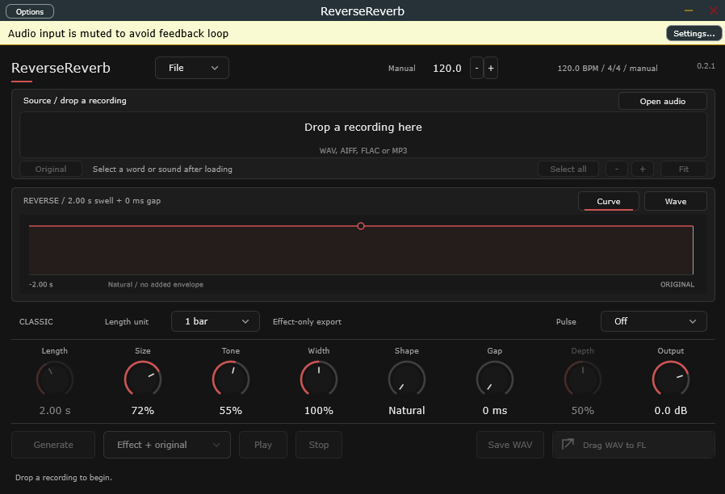

# ReverseReverb

A Windows audio tool that reverses a sound and shapes the reverb tail leading into it — the reverse-reverb lead-in trick, as a small app and a VST3.

Made with C++ and JUCE. Drop a file in, pick the part you want, generate, listen, then save it or drag it straight into FL Studio.



## Status

- **File mode is the finished path** — load a recording, pick a word, generate, drag out a WAV.
- **Track mode is a demo.** It buffers the audio coming through the FL mixer channel and plays the effect back so you can hear it while arranging. It does not yet follow real seeks or live transport changes reliably, and it has not been checked against FL's own latency compensation, automation or song export. It's a preview of where the plugin is going, not a feature to rely on for a finished track.

## Quick setup (no build)

1. Download **`ReverseReverb-0.2.1-win64.zip`** from [Releases](https://github.com/stefanovic000/ReverseReverb/releases/latest) and extract it.
2. Either run **`ReverseReverb.exe`** — the standalone app needs no install — or copy the whole **`ReverseReverb.vst3`** folder into `C:\Program Files\Common Files\VST3`.
3. In FL Studio: **Options → Manage plugins → Find more plugins**, then scan.

## Build from source

1. Install **Visual Studio** with the *Desktop development with C++* workload. CMake and Ninja come with it.
2. Clone and build (Release, with the checks run automatically):

   ```powershell
   git clone https://github.com/stefanovic000/ReverseReverb.git
   cd ReverseReverb
   ./scripts/build.ps1 -Configuration Release
   ```

   The first build downloads JUCE into `.dependencies/`, so it takes a few minutes.

3. The artefacts land in:

   | Artefact | Path |
   |---|---|
   | Standalone app | `build/msvc-Release/ReverseReverb_artefacts/Release/Standalone/ReverseReverb.exe` |
   | VST3 | `build/msvc-Release/ReverseReverb_artefacts/Release/VST3/ReverseReverb.vst3` |

## Use

1. Drop a WAV, AIFF, FLAC or MP3 into the window.
2. Pick the word or sound to process.
3. Adjust Length, Size, Tone, Width, Shape, Gap, Depth, Output.
4. Generate → Play → Save WAV (or drag into FL Studio).

## Docs

The long notes live in [`docs/`](docs):

| File | What's in it |
|---|---|
| [AUDIO.md](docs/AUDIO.md) | how the reverb tail is built |
| [REVERB_CHARACTERS.md](docs/REVERB_CHARACTERS.md) | room / hall / plate voicings |
| [TRACK_MODE.md](docs/TRACK_MODE.md) | the beta track mode |
| [UI_PLAN.md](docs/UI_PLAN.md) | interface decisions |
| [ROADMAP.md](docs/ROADMAP.md) | what's done, what's next |
| [PLAN.md](docs/PLAN.md) | original scope |
| [WORKFLOW.md](docs/WORKFLOW.md) | capture-to-FL workflow |
